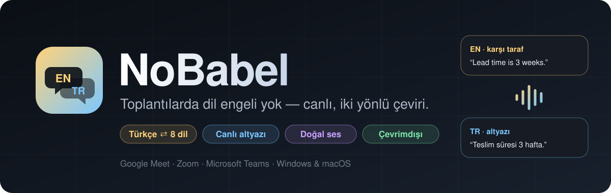
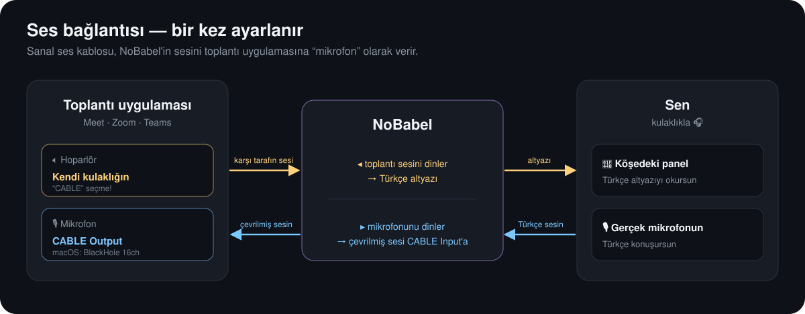

# NoBabel kurulum rehberi

Bu rehber NoBabel'i indirip **Windows** ya da **Mac**'te ilk kez çalıştırmayı adım adım anlatır. Toplam süre yaklaşık 10–15 dakikadır; bunun çoğu ilk açılıştaki model indirmesidir.

- [Windows](#windows)
- [Mac](#mac)
- [Toplantı uygulamasını ayarlama (Meet · Zoom · Teams)](#toplantı-uygulamasını-ayarlama)
- [İlk kullanım](#ilk-kullanım)
- [Sorun giderme](#sorun-giderme)

> 🎧 **Kulaklık şart.** Hoparlörden çıkan ses mikrofona girerse karşı tarafın sözleri senin konuşman gibi çevrilir.

---

## Windows

**Gerekenler:** Windows 10 ya da 11 (64 bit), kulaklık, ilk açılış için internet, yaklaşık 2 GB boş alan.

### 1. Sanal ses kablosunu kur (bir kez)

NoBabel'in çevirdiği sesin toplantıya “mikrofon” olarak gidebilmesi için ücretsiz **VB-Audio Virtual Cable** gerekir.

1. <https://vb-audio.com/Cable/> adresinden **Download** ile zip dosyasını indir.
2. Zip'i bir klasöre çıkar.
3. **`VBCABLE_Setup_x64.exe`** dosyasına sağ tıkla → **Yönetici olarak çalıştır** → **Install Driver**.
4. Bilgisayarı **yeniden başlat**.

### 2. NoBabel'i indir ve kur

1. **[NoBabel-Setup-1.0.0.exe](https://github.com/emrettc/nobabel/releases/latest/download/NoBabel-Setup-1.0.0.exe)** dosyasını indir.
2. İndirilen dosyaya çift tıkla.
3. Mavi bir **“Windows bilgisayarınızı korudu”** penceresi çıkarsa:
   **Ek bilgi** → **Yine de çalıştır**.
   *(NoBabel henüz kod imzalı olmadığı için bu uyarı çıkar; dosya güvenlidir.)*
4. Kurulum sihirbazında **İleri → Kur → Son**. Yönetici şifresi istemez.
   Sonda açılan VB-Cable sayfasını, kablo zaten kuruluysa kapatabilirsin.
5. Masaüstünde **NoBabel** simgesi oluşur.

### 3. Windows ses çıkışını kontrol et

Görev çubuğunda sağ alttaki 🔊 simgesine tıkla → ses çıkışı olarak **kendi kulaklığını** seç.
**“CABLE Input” seçili olmamalı**; yoksa toplantı sesini duyamazsın ve NoBabel de duyamaz.

### 4. İlk açılış

**NoBabel**'i aç. İlk açılışta küçük bir pencere çeviri ve ses modellerini indirir. İngilizce ⇄ Türkçe için yaklaşık 1,3 GB tutar ve birkaç dakika sürer. Bitince ekranın köşesinde altyazı paneli belirir.

Sonra [toplantı uygulamasını ayarla](#toplantı-uygulamasını-ayarlama).

**Kaldırmak için:** Ayarlar → Uygulamalar → NoBabel → Kaldır.

---

## Mac

**Gerekenler:** macOS 12 (Monterey) ya da daha yeni, kulaklık, ilk açılış için internet, yaklaşık 2 GB boş alan.

### 1. Hangi Mac'in var?

Sol üstteki  menüsü → **Bu Mac Hakkında**:

| “Çip” satırında… | İndireceğin dosya |
|---|---|
| **Apple M1 / M2 / M3 / M4** | **[NoBabel-1.0.0-macOS-apple-silicon.dmg](https://github.com/emrettc/nobabel/releases/latest/download/NoBabel-1.0.0-macOS-apple-silicon.dmg)** |
| “İşlemci” satırında **Intel** | **[NoBabel-1.0.0-macOS-intel.dmg](https://github.com/emrettc/nobabel/releases/latest/download/NoBabel-1.0.0-macOS-intel.dmg)** |

### 2. Sanal ses kartlarını kur (bir kez)

NoBabel toplantı sesini duymak ve çevirdiği sesi toplantıya göndermek için ücretsiz **BlackHole**'u kullanır. İki tane gerekir:

1. <https://existential.audio/blackhole/> adresinden **BlackHole 2ch** ve **BlackHole 16ch**'yi indirip kur.
   *Homebrew kullanıyorsan:* `brew install blackhole-2ch blackhole-16ch`
2. Mac'i **yeniden başlat**.

### 3. Toplantı sesini NoBabel'e de yolla (bir kez)

1. **Audio MIDI Setup** (Ses MIDI Ayarı) uygulamasını aç; Spotlight'ta (⌘ Boşluk) adını yazman yeterli.
2. Sol alttaki **+** → **Create Multi-Output Device** (Çoklu Çıkış Aygıtı Oluştur).
3. Sağdaki listede **kulaklığını** ve **BlackHole 2ch**'yi işaretle. Kulaklığın **Primary** (birincil) olsun.
4. **Sistem Ayarları → Ses → Çıkış** → **Multi-Output Device**'ı seç.

> Bundan sonra Mac'in sesi hem kulaklığına hem NoBabel'e gider. NoBabel'i kullanmadığın zaman çıkışı tekrar kulaklığına alabilirsin.

### 4. NoBabel'i kur

1. İndirdiğin `.dmg` dosyasına çift tıkla.
2. Açılan pencerede **NoBabel** simgesini **Applications** klasörüne sürükle.
3. **Applications** klasöründen **NoBabel**'i aç.
4. **“NoBabel açılamadı / Apple doğrulayamadı”** uyarısı çıkarsa **Bitti**'ye bas, sonra:
   **Sistem Ayarları → Gizlilik ve Güvenlik** → aşağı kaydır → “NoBabel engellendi” satırında **Yine de Aç** → şifreni gir → **Aç**.
   *(NoBabel henüz Apple tarafından imzalı olmadığı için bu adım bir kez gerekir.)*
5. **Mikrofon izni** sorulunca **İzin Ver**.
   *(Yanlışlıkla reddettiysen: Sistem Ayarları → Gizlilik ve Güvenlik → Mikrofon → NoBabel'i aç.)*

### 5. İlk açılış

İlk açılışta küçük bir pencere çeviri ve ses modellerini indirir. İngilizce ⇄ Türkçe için yaklaşık 1,3 GB tutar ve birkaç dakika sürer. Bitince ekranın köşesinde altyazı paneli belirir.

Sonra [toplantı uygulamasını ayarla](#toplantı-uygulamasını-ayarlama).

**Kaldırmak için:** Applications'tan NoBabel'i Çöp Sepeti'ne at. İndirilen modeller `~/Library/Application Support/NoBabel` klasöründe durur; istersen onu da silebilirsin.

---

## Toplantı uygulamasını ayarlama

Toplantı uygulamasının ses ayarlarında **mikrofonu** sanal kabloya, **hoparlörü** kulaklığına ayarla:

| Uygulama | Nerede? | Mikrofon (Windows) | Mikrofon (Mac) | Hoparlör |
|---|---|---|---|---|
| **Google Meet** | Toplantıda ⋮ → Ayarlar → Ses | `CABLE Output (VB-Audio Virtual Cable)` | `BlackHole 16ch` | Kulaklığın |
| **Zoom** | Ayarlar → Ses | `CABLE Output (VB-Audio Virtual Cable)` | `BlackHole 16ch` | Kulaklığın |
| **Microsoft Teams** | Ayarlar → Cihazlar | `CABLE Output (VB-Audio Virtual Cable)` | `BlackHole 16ch` | Kulaklığın |

> ⚠️ Hoparlör olarak “CABLE” ya da “BlackHole” **seçme**; seçersen karşı tarafı duyamazsın.

---

## İlk kullanım

Altyazı paneli ekranın köşesinde durur. Üstündeki şeritte şu düğmeler var:

| Düğme | Ne yapar? |
|---|---|
| `🌐EN▾` | **Karşı tarafın dilini seç.** Yeni bir dil seçince o dilin modelleri kendiliğinden indirilir (~0,5 GB) |
| `EN→TR` / `TR→EN` | O yönü aç/kapat |
| `🔇` / `🔊` | Türkçe çeviriyi kulaklıkta sesli de dinle |
| `Yerel` / `Claude` | Çeviri motoru (Claude için ⚙'dan kendi API anahtarını gir) |
| `A−` / `A+` | Yazı boyutu |
| `🔒` | Kilidi aç → paneli taşı ve boyutlandır |
| `⚙` | Ayarlar: ses seçimi, hız, ElevenLabs, Claude |
| `✕` | Kapat |

**İpuçları**
- Kısa, net cümleler kur; cümle sonunda yarım saniye dur. NoBabel cümlenin bittiğini sessizlikten anlar.
- Sarı satırlar (◂) karşı tarafın sözleri, mavi satırlar (▸) senin sözlerin. İtalik satır, konuşma sürerken akan geçici çeviridir.
- Panel tıklamaları arkasındaki pencereye geçirir ve ekran paylaşımında görünmez (Windows).

---

## Sorun giderme

| Belirti | Çözüm |
|---|---|
| **Altyazı gelmiyor** | **Windows:** ses çıkışı “CABLE” olmuş olabilir; 🔊 simgesinden kulaklığını seç. **Mac:** Sistem Ayarları → Ses → Çıkış **Multi-Output Device** olmalı |
| **Karşı taraf beni duymuyor** | Toplantı uygulamasında mikrofon `CABLE Output` (Windows) / `BlackHole 16ch` (Mac) olmalı. Panelde ⚠ uyarısı varsa okuyun |
| **Panelde “Sanal mikrofon yok” uyarısı** | VB-Cable ya da BlackHole kurulmamış veya kurulumdan sonra bilgisayar yeniden başlatılmamış |
| **İlk açılışta “İndirilemedi”** | İnternet bağlantısını kontrol et ve **Tekrar dene**'ye bas. Kurumsal ağda github.com ve huggingface.co erişimi açık olmalı |
| **Mac: “hasar görmüş, açılamıyor”** | Terminal'de bir kez çalıştır: `xattr -dr com.apple.quarantine /Applications/NoBabel.app` |
| **Mac: mikrofon çalışmıyor** | Sistem Ayarları → Gizlilik ve Güvenlik → Mikrofon → **NoBabel** açık olmalı |
| **Windows: “Windows bilgisayarınızı korudu”** | **Ek bilgi → Yine de çalıştır** |
| **Saçma yazılar (“Altyazı M.K.” gibi)** | Ortam gürültüsü yazıya dökülüyor; kulaklık mikrofonu kullan, gürültülü ortamdan uzaklaş |
| **Çeviri gecikiyor** | Dizüstünü prize tak; Windows'ta güç modunu “En iyi performans” yap |

Başka bir sorun mu var? Kayıt dosyası şurada:
- **Windows:** `%LOCALAPPDATA%\NoBabel\data\app.log` (Dosya Gezgini'nin adres çubuğuna yapıştır)
- **Mac:** `~/Library/Application Support/NoBabel/data/app.log` (Finder → Git → Klasöre Git)

---

<a href="README.md">← Ana sayfa</a>

