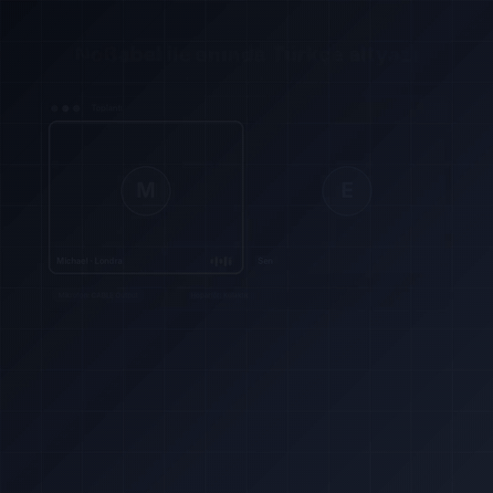
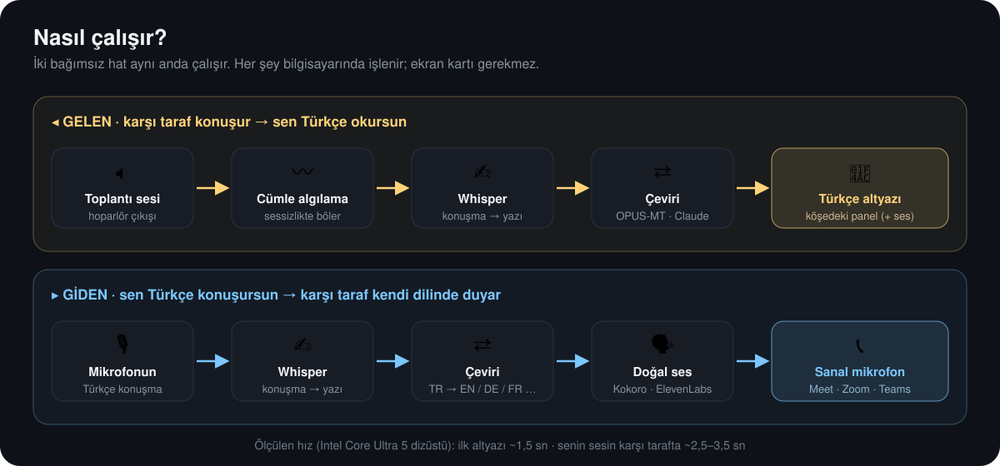
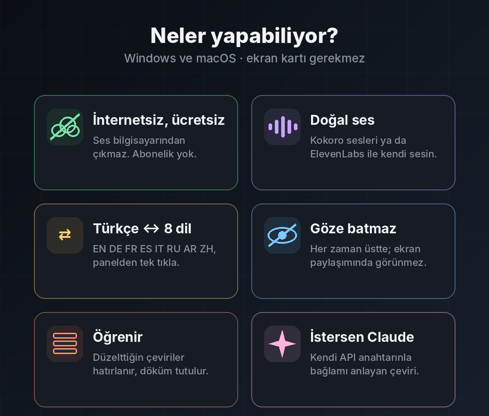
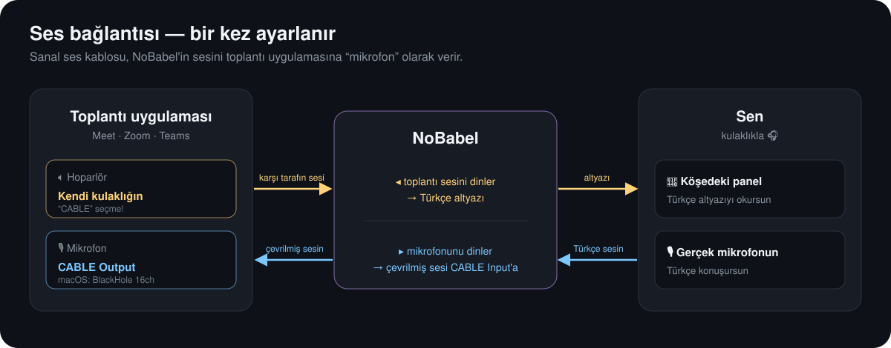

  

<h3 align="center">Kendi dilinde konuş. Herkesi anla.</h3>

  
  &nbsp;
  
  &nbsp;
  

Sürüm 1.0.0 · Windows 10/11 (64 bit) · macOS 12+ · Tüm sürümler: <a href="../../releases">Releases</a>

   
  ▶ <a href="docs/nobabel-tanitim.mp4">36 saniyelik tanıtım videosunu izle</a>

---

**NoBabel**, görüntülü toplantılarda **canlı, iki yönlü çeviri** yapan bir masaüstü uygulamasıdır. Google Meet, Zoom, Microsoft Teams ya da sesi bilgisayardan geçen her uygulamayla çalışır.

| | |
|---|---|
| 🗣 **Karşı taraf kendi dilinde konuşur** | Ekranın köşesinde **Türkçe altyazı** akar. İstersen kulaklıkta Türkçe ses de duyarsın. |
| 🎙 **Sen Türkçe konuşursun** | Sözlerin karşı tarafın diline çevrilir ve **doğal bir sesle** toplantıya gider. |
| 🔒 **İnternetsiz çalışır** | Ses bilgisayarından çıkmaz. Ücretsiz, abonelik yok. |

   
  Köşedeki altyazı paneli. ◂ sarı = karşı taraf, ▸ mavi = sen. İtalik satır: konuşma sürerken akan çeviri.

## Nasıl çalışır?

## Desteklenen diller

Sen **Türkçe** konuşursun; karşı taraf şu dillerden birini konuşabilir — panelden tek tıkla değiştirilir:

| 🇬🇧 İngilizce | 🇩🇪 Almanca | 🇫🇷 Fransızca | 🇪🇸 İspanyolca | 🇮🇹 İtalyanca | 🇷🇺 Rusça | 🇸🇦 Arapça | 🇨🇳 Çince |
|:-:|:-:|:-:|:-:|:-:|:-:|:-:|:-:|

## Öne çıkanlar

- **Hızlı:** İlk altyazı ~1,5 saniyede; senin sesin sözün bittikten ~2,5–3,5 saniye sonra karşı tarafta. Ekran kartı gerekmez.
- **Göze batmaz:** Panel her zaman üstte durur ama tıklamalar arkasındaki pencereye geçer, odak çalmaz ve **ekran paylaşımında görünmez** (Windows).
- **Doğal ses:** Yerel ve ücretsiz Kokoro sesleri; istersen ElevenLabs ile **kendi sesinin klonu**.
- **Daha iyi çeviri, istersen:** Kendi Claude API anahtarınla bağlamı anlayan çeviri. Sorun olursa kendiliğinden yerel çeviriye döner.
- **Öğrenir:** Düzelttiğin çeviriler hatırlanır; toplantı dökümü otomatik kaydedilir.
- **Sektörüne uyar:** Firma, ürün ve terim adlarını ekleyerek tanıma doğruluğunu artırabilirsin.

## Kurulum

| | Windows 10/11 | Mac (macOS 12+) |
|---|---|---|
| **1. Sanal ses kablosu** (bir kez) | [VB-Audio Virtual Cable](https://vb-audio.com/Cable/) kur, yeniden başlat | [BlackHole 2ch + 16ch](https://existential.audio/blackhole/) kur, yeniden başlat |
| **2. NoBabel'i indir** | [**NoBabel-Setup.exe**](https://github.com/emrettc/nobabel/releases/latest/download/NoBabel-Setup-1.0.0.exe) | [**Apple Silicon (M1–M4)**](https://github.com/emrettc/nobabel/releases/latest/download/NoBabel-1.0.0-macOS-apple-silicon.dmg) · [**Intel**](https://github.com/emrettc/nobabel/releases/latest/download/NoBabel-1.0.0-macOS-intel.dmg) |
| **3. Kur** | Çift tıkla → uyarı çıkarsa **Ek bilgi → Yine de çalıştır** → İleri → Kur | `.dmg`'yi aç → NoBabel'i **Applications**'a sürükle → uyarı çıkarsa **Sistem Ayarları → Gizlilik ve Güvenlik → Yine de Aç** |
| **4. Ses çıkışı** | 🔊 simgesinden **kulaklığını** seç (“CABLE” değil) | Audio MIDI Setup'ta **Multi-Output Device** (kulaklık + BlackHole 2ch) oluştur ve çıkış yap |
| **5. Toplantıda mikrofon** | `CABLE Output` | `BlackHole 16ch` |
| **6. İlk açılış** | Modeller bir kez indirilir (~1,3 GB, birkaç dakika) | Modeller bir kez indirilir (~1,3 GB, birkaç dakika) |

👉 **Adım adım anlatım, toplantı uygulaması ayarları ve sorun giderme: [KURULUM.md](KURULUM.md)**

> 🎧 **Mutlaka kulaklık kullan.** Hoparlörden çıkan ses mikrofona girerse karşı tarafın sözleri senin konuşman gibi çevrilir.

## Sık sorulan sorular

<b>İnternet gerekiyor mu?</b>

Yalnızca ilk açılışta (ve yeni bir dil seçince) modelleri indirmek için. Sonrasında tamamen çevrimdışı çalışır. Claude çevirisi ya da ElevenLabs/Edge sesleri seçersen bunlar internet kullanır.

<b>Ücretli mi?</b>

NoBabel ücretsizdir. İsteğe bağlı Claude API ve ElevenLabs kendi hesabınla, o servislerin ücretlendirmesiyle çalışır.

<b>Konuşmalarım bir yere gönderiliyor mu?</b>

Varsayılan ayarlarda hayır: ses, yazıya çevirme, çeviri ve seslendirme bilgisayarında yapılır. Yalnızca Claude modunda yazıya çevrilmiş metin Anthropic'e, ElevenLabs/Edge seçilirse çevrilmiş metin o servise gider. Toplantı dökümleri yalnızca senin bilgisayarında durur.

<b>iPhone / iPad'de çalışır mı?</b>

Hayır. iOS, bir uygulamanın başka uygulamaların sesini dinlemesine ve sanal mikrofon oluşturmasına izin vermez.

<b>Kurulumda “Windows bilgisayarınızı korudu” / Mac'te “doğrulanamadı” uyarısı çıkıyor.</b>

NoBabel henüz kod imzalı olmadığı için bu uyarılar bir kez çıkar. Windows'ta **Ek bilgi → Yine de çalıştır**; Mac'te **Sistem Ayarları → Gizlilik ve Güvenlik → Yine de Aç**. Ayrıntılar: [KURULUM.md](KURULUM.md).

<b>Karşı taraf beni duymuyor ya da altyazı gelmiyor.</b>

Toplantıdaki mikrofonun `CABLE Output` (macOS'ta `BlackHole 16ch`) olduğunu ve bilgisayarın ses çıkışının “CABLE” değil, kendi kulaklığın olduğunu kontrol et. Panel yanlış ayarı fark ederse ⚠ uyarısı gösterir.

<b>Bilgisayar gereksinimleri?</b>

Windows 10/11 (64 bit) ya da macOS 12+, 8 GB RAM önerilir. Uygulama ~250 MB; İngilizce ⇄ Türkçe modelleri ~1,3 GB, her ek dil ~0,5 GB. Ekran kartı gerekmez.

---

Toplantıdaki kişilere canlı çeviri kullandığını söylemen iyi olur. · Kullanılan açık kaynak bileşenler ve lisansları uygulama klasöründeki THIRD_PARTY_LICENSES.md dosyasındadır.

