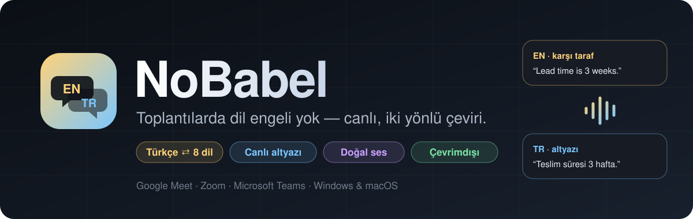
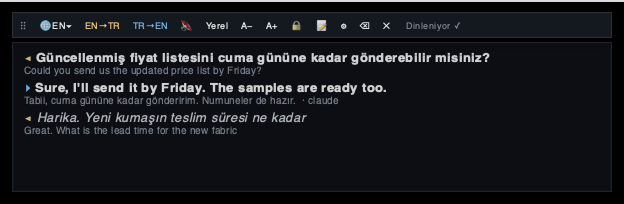

  

<h3 align="center">Kendi dilinde konuş. Herkesi anla.</h3>

  
  &nbsp;
  

Kurulum paketleri <a href="../../releases">Releases</a> sayfasında yayınlanır.

---

**NoBabel**, görüntülü toplantılarda **canlı, iki yönlü çeviri** yapan bir masaüstü uygulamasıdır. Google Meet, Zoom, Microsoft Teams ya da sesi bilgisayardan geçen her uygulamayla çalışır.

| | |
|---|---|
| 🗣 **Karşı taraf kendi dilinde konuşur** | Ekranın köşesinde **Türkçe altyazı** akar. İstersen kulaklıkta Türkçe ses de duyarsın. |
| 🎙 **Sen Türkçe konuşursun** | Sözlerin karşı tarafın diline çevrilir ve **doğal bir sesle** toplantıya gider. |
| 🔒 **İnternetsiz çalışır** | Ses bilgisayarından çıkmaz. Ücretsiz, abonelik yok. |

   
  Köşedeki altyazı paneli. ◂ sarı = karşı taraf, ▸ mavi = sen. İtalik satır: konuşma sürerken akan çeviri.

## Nasıl çalışır?

## Desteklenen diller

Sen **Türkçe** konuşursun; karşı taraf şu dillerden birini konuşabilir — panelden tek tıkla değiştirilir:

| 🇬🇧 İngilizce | 🇩🇪 Almanca | 🇫🇷 Fransızca | 🇪🇸 İspanyolca | 🇮🇹 İtalyanca | 🇷🇺 Rusça | 🇸🇦 Arapça | 🇨🇳 Çince |
|:-:|:-:|:-:|:-:|:-:|:-:|:-:|:-:|

## Öne çıkanlar

- **Hızlı:** İlk altyazı ~1,5 saniyede; senin sesin sözün bittikten ~2,5–3,5 saniye sonra karşı tarafta. Ekran kartı gerekmez.
- **Göze batmaz:** Panel her zaman üstte durur ama tıklamalar arkasındaki pencereye geçer, odak çalmaz ve **ekran paylaşımında görünmez** (Windows).
- **Doğal ses:** Yerel ve ücretsiz Kokoro sesleri; istersen ElevenLabs ile **kendi sesinin klonu**.
- **Daha iyi çeviri, istersen:** Kendi Claude API anahtarınla bağlamı anlayan çeviri. Sorun olursa kendiliğinden yerel çeviriye döner.
- **Öğrenir:** Düzelttiğin çeviriler hatırlanır; toplantı dökümü otomatik kaydedilir.
- **Sektörüne uyar:** Firma, ürün ve terim adlarını ekleyerek tanıma doğruluğunu artırabilirsin.

## Kurulum

### Windows 10/11

1. [VB-Audio Virtual Cable](https://vb-audio.com/Cable/)'ı kur (zip içindeki `VBCABLE_Setup_x64.exe`, **yönetici olarak**) ve bilgisayarı yeniden başlat.
2. [Releases](../../releases/latest) sayfasından **Windows kurulum dosyasını** indirip çalıştır.
3. Görev çubuğundaki 🔊 simgesinden çıkış olarak **kendi kulaklığını** seç (“CABLE” değil).
4. Toplantı uygulamasında **Mikrofon → `CABLE Output`**, Hoparlör → kulaklığın.

### macOS 12+

1. [BlackHole 2ch ve 16ch](https://existential.audio/blackhole/)'yi kur, Mac'i yeniden başlat.
2. [Releases](../../releases/latest) sayfasından **macOS paketini** indir ve uygulamayı Programlar'a sürükle.
3. **Audio MIDI Setup → + → Multi-Output Device**: kulaklığın + BlackHole 2ch. Sistem çıkışını bu cihaz yap.
4. Toplantı uygulamasında **Mikrofon → `BlackHole 16ch`**, Hoparlör → kulaklığın.

> 🎧 **Mutlaka kulaklık kullan.** Hoparlörden çıkan ses mikrofona girerse karşı tarafın sözleri senin konuşman gibi çevrilir.

## Sık sorulan sorular

<b>İnternet gerekiyor mu?</b>

Yalnızca ilk kurulumda modelleri indirmek için. Sonrasında tamamen çevrimdışı çalışır. Claude çevirisi ya da ElevenLabs/Edge sesleri seçersen bunlar internet kullanır.

<b>Ücretli mi?</b>

NoBabel ücretsizdir. İsteğe bağlı Claude API ve ElevenLabs kendi hesabınla, o servislerin ücretlendirmesiyle çalışır.

<b>Konuşmalarım bir yere gönderiliyor mu?</b>

Varsayılan ayarlarda hayır: ses, yazıya çevirme, çeviri ve seslendirme bilgisayarında yapılır. Yalnızca Claude modunda yazıya çevrilmiş metin Anthropic'e, ElevenLabs/Edge seçilirse çevrilmiş metin o servise gider. Toplantı dökümleri yalnızca senin bilgisayarında durur.

<b>iPhone / iPad'de çalışır mı?</b>

Hayır. iOS, bir uygulamanın başka uygulamaların sesini dinlemesine ve sanal mikrofon oluşturmasına izin vermez.

<b>Karşı taraf beni duymuyor ya da altyazı gelmiyor.</b>

Toplantıdaki mikrofonun `CABLE Output` (macOS'ta `BlackHole 16ch`) olduğunu ve bilgisayarın ses çıkışının “CABLE” değil, kendi kulaklığın olduğunu kontrol et. Panel yanlış ayarı fark ederse ⚠ uyarısı gösterir.

<b>Bilgisayar gereksinimleri?</b>

Windows 10/11 ya da macOS 12+, 8 GB RAM önerilir, yalnızca İngilizce için ~2 GB, 8 dilin tamamı için ~4,5 GB boş alan. Ekran kartı gerekmez.

---

Toplantıdaki kişilere canlı çeviri kullandığını söylemen iyi olur. · Kullanılan açık kaynak modeller ve lisansları kurulum paketindeki lisans dosyasında listelenir.

